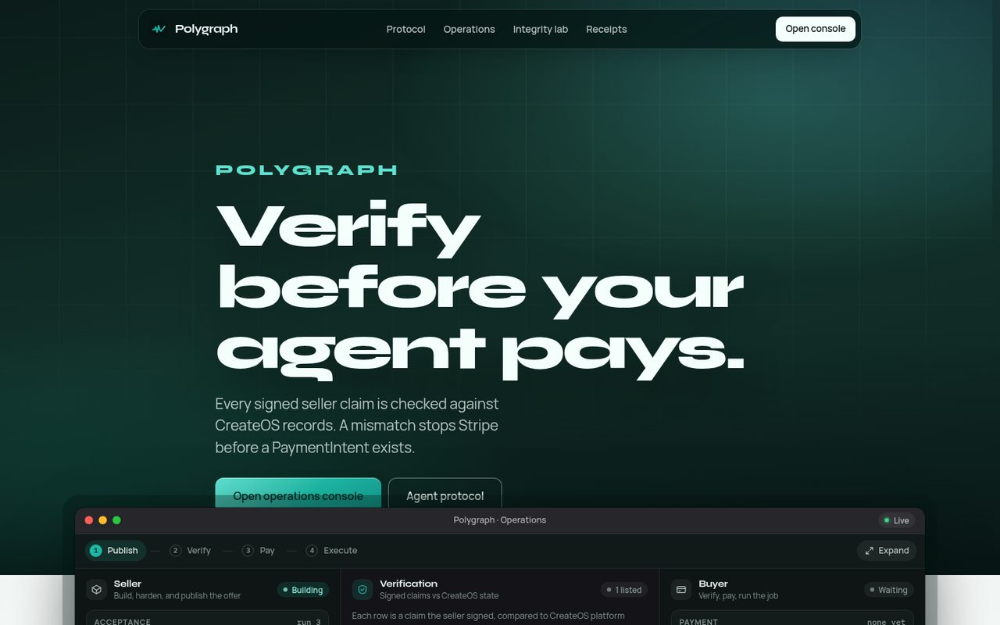
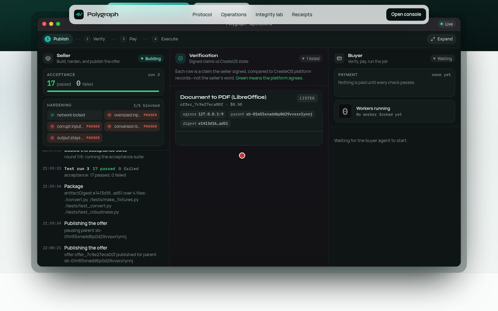
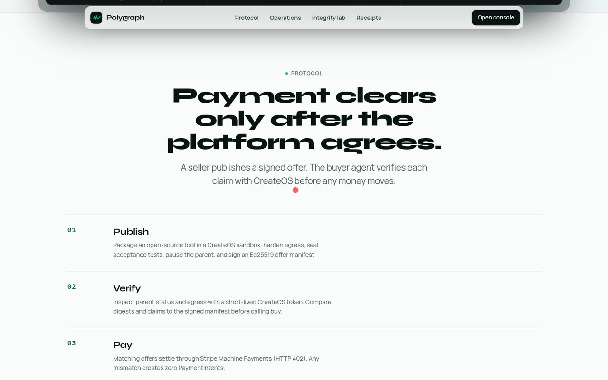
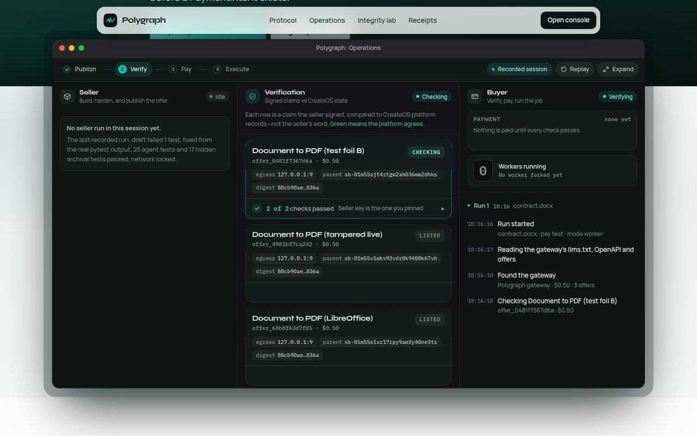
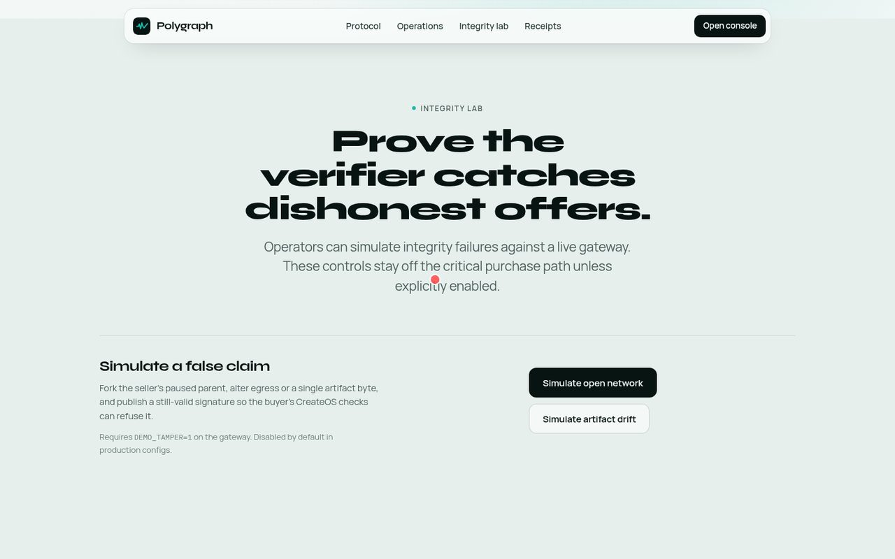
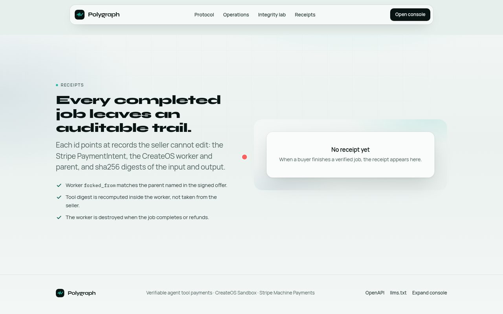

# Polygraph

Agents that buy tools from strangers need proof the sandbox matches the offer. Polygraph sits between the buyer agent and Stripe: it checks CreateOS records against the seller’s signed claims, and only then lets payment clear.

A failed check means **no PaymentIntent**. A post-pay integrity failure means a full refund and a destroyed worker.

<p align="center">
  
</p>

Built on [CreateOS Sandboxes](https://createos.sh) and [Stripe Machine Payments](https://docs.stripe.com) (test mode). Architecture adapted from [kinnuworks/polygraph](https://github.com/kinnuworks/polygraph).

---

## What you get

| Piece | What it actually does |
| --- | --- |
| **Seller agent** | Packages a tool (default: LibreOffice / `unoserver`) in a sandbox, hardens egress, seals a Python acceptance suite, pauses the parent, signs an Ed25519 offer |
| **Gateway** | Offer registry, short-lived inspect tokens, HTTP 402 MPP charges, warm worker pool, SSE event feed, product UI |
| **Buyer agent** | Verifies JWS + CreateOS state before paying; re-checks the worker after pay; runs the job or refunds |
| **Operations console** | Live (or recorded) view of publish → verify → pay → execute |

First listing in the tree is a document→PDF converter at **$0.50 / job**. The converter is an example; the product is the verify-before-pay path.

<p align="center">
  
</p>

---

## Protocol (short)

1. **Publish** — seller builds, tests, locks egress, pauses parent, signs `OfferManifest`
2. **Verify** — buyer checks signature, then asks CreateOS (not the seller) for status / egress / digests
3. **Pay** — `POST /offers/:id/buy` → 402 challenge → Stripe test charge → worker fork
4. **Execute** — buyer re-audits the worker, uploads input, runs the job, keeps a receipt; or refunds

<p align="center">
  
</p>

If any pre-pay claim disagrees with CreateOS, the buyer refuses and Stripe never sees a charge.

---

## Repo layout

```text
packages/core     types, Ed25519 JWS, CreateOS helpers, events
apps/seller       CLI: build / harden / acceptance / publish
apps/gateway      Hono server + static UI (port 4242)
apps/buyer        CLI: distrust → pay → verify → run
apps/web/public   product site + operations console
tests/            e2e with mocked CreateOS + Stripe
docs/images/      README screenshots
```

---

## Quick start (UI only)

No API keys needed for the static preview + recorded session:

```bash
npm install
npm run preview
# open http://localhost:4242/
# recorded session: http://localhost:4242/?demo=1
```

<p align="center">
  
</p>

```bash
npm run typecheck
npm test
```

---

## Live stack

Needs Node **≥ 20**, a CreateOS sandbox key, Stripe **test** keys (`sk_test_…`), an MPP profile, and Anthropic (seller build loop).

```bash
cp .env.example .env
# fill CREATEOS_SANDBOX_API_KEY, STRIPE_SECRET_KEY, STRIPE_PROFILE_ID,
# MPP_SECRET_KEY, ANTHROPIC_API_KEY, SELLER_SIGNING_KEY
```

Keys:

```bash
openssl genpkey -algorithm ed25519 | base64 | tr -d '\n'   # SELLER_SIGNING_KEY
openssl rand -hex 32                                       # MPP_SECRET_KEY
```

Live keys are rejected on purpose — gateway and buyer both require `_test_` in `STRIPE_SECRET_KEY`.

### Terminals

```bash
# 1 — gateway + UI
npm run gateway

# 2 — publish an offer
npm run seller

# 3 — buy and convert
npm run buyer -- --file apps/buyer/fixtures/contract.docx --trust-seller
```

Buyer flags worth knowing:

| Flag | Meaning |
| --- | --- |
| `--pay test` | Stripe test Shared Payment Token (default) |
| `--pay link` | Link wallet via `@stripe/link-cli` (still test mode) |
| `--mode worker` | run in seller’s forked worker (default) |
| `--mode own` | copy verified tool into the buyer’s CreateOS account |
| `--trust-seller` | pin seller pubkey for this gateway on first use |

Integrity matrix (optional):

```bash
npm run tamper-matrix -- --gateway http://localhost:4242
```

---

## Integrity lab

Operator-only. Off by default (`DEMO_TAMPER=0`, `DEMO_FOILS=0`). When enabled, the UI can fork the seller parent, open egress or flip one artifact byte, and republish a still-valid signature so you can watch the buyer refuse.

<p align="center">
  
</p>

---

## Receipts

Every completed job leaves ids you can check yourself: Stripe PaymentIntent, CreateOS parent + worker, input/output sha256. Workers are destroyed on `done` or refund.

<p align="center">
  
</p>

---

## HTTP surface

| Method | Path | Notes |
| --- | --- | --- |
| `GET` | `/offers`, `/offers/:id` | signed offers |
| `GET` | `/offers/:id/inspect` | short-lived CreateOS parent token (~60s) |
| `POST` | `/offers/:id/buy` | MPP 402 → grant (`workerToken`, `purchaseSecret`, …) |
| `POST` | `/purchases/:id/refund` | gateway re-audits, then Stripe refund |
| `POST` | `/purchases/:id/done` | destroy worker |
| `GET` | `/events` | SSE feed (replays ~200, then live) |
| `GET` | `/openapi.json`, `/llms.txt` | for agents |
| `GET` | `/health` | uptime + warm pool size |

Agents: start at [`/llms.txt`](http://localhost:4242/llms.txt) when the gateway is up.

---

## Env reference

| Variable | Who | Required |
| --- | --- | --- |
| `CREATEOS_SANDBOX_API_KEY` | gateway, seller | yes (live) |
| `STRIPE_SECRET_KEY` | gateway, buyer | yes (`sk_test_` / `rk_test_`) |
| `STRIPE_PROFILE_ID` | gateway | yes |
| `MPP_SECRET_KEY` | gateway | yes |
| `ANTHROPIC_API_KEY` | seller | yes (unless `--tamper` / `--skip-build`) |
| `SELLER_SIGNING_KEY` | seller, integrity lab | yes |
| `POLYGRAPH_GATEWAY_URL` | buyer, seller | default `http://localhost:4242` |
| `DEMO_FOILS` / `DEMO_TAMPER` | gateway | default `0` |
| `POOL_SIZE` | gateway | default `1` |
| `BUYER_CREATEOS_SANDBOX_API_KEY` | buyer `--mode own` | optional |

Full list: [`.env.example`](.env.example).

---

## What this proves / doesn’t

**Proves (against CreateOS, not seller word):** parent paused, egress matches claim, worker `forked_from` lineage, artifact digest recomputed in-worker.

**Does not prove:** the tool is bug-free, or that the seller’s account can’t read files inside a worker they own. Don’t send secrets the seller must never see.

---

## Scripts

| Script | |
| --- | --- |
| `npm run gateway` | HTTP gateway + UI |
| `npm run seller` | publish offer |
| `npm run buyer` | verify / pay / run |
| `npm run tamper-matrix` | six integrity cases |
| `npm run preview` | UI + recorded session, no keys |
| `npm test` | local e2e (mocked externals) |
| `npm run typecheck` | `tsc --noEmit` |
